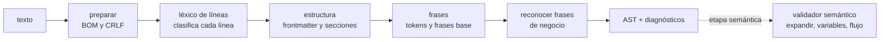

# Semana 03 — Analizador: léxico y sintaxis

- **Fecha:** viernes 30 de octubre de 2026
- **Rama:** `semana03/analizador`
- **Estado:** Aprobado el 11 de noviembre de 2026, con los ajustes de la revisión escrita (§14).
- **Entrega:** PR «Analizador», lunes 16 de noviembre (iteración 1 del plan de cierre).

## 1. Resumen

La semana 2 dejó el lenguaje especificado en papel: la especificación v0.1, la gramática EBNF, el JSON Schema del AST, 12 historias válidas y 19 casos inválidos. Esta iteración construye la primera pieza que lo lee: **el analizador**, que convierte un `.historia.md` en el AST, y la **CLI `custodio validar`**, que lo usa.

- **ADR-003:** analizador **escrito a mano**, por descenso recursivo en dos niveles (líneas y frases), sin dependencias. La regla 6 ya impide librerías externas en `lenguaje/`, y los mensajes de error en español son la mitad del valor del lenguaje (DSL-12).
- **Recuperación de errores:** cada línea se analiza por separado y cada sección termina en el próximo título, así que un error nunca arrastra al resto del archivo. Se informan todos los errores, sin cascadas.
- **Posiciones:** línea y columna desde 1, contando puntos de código sobre el texto original. La normalización Unicode se usa solo al comparar (§4.1).
- **El límite entre las dos etapas:** la **sintaxis** (este PR) hace todo lo que se decide mirando **una frase o un archivo**: la estructura, las frases base y reconocer frases de negocio. La **semántica** (PR «Del texto al plan») hace lo que necesita **seguir referencias**: expandir frases, variables, capturas, secretos, el ambiente y el flujo del escenario. Con eso, **15 de los 20 casos inválidos** son de sintaxis y los otros 5, de semántica.
- **El PR del analizador** entrega el analizador en `src/lenguaje/`, la CLI en `src/arranque/cli/`, los ejemplos del AST como salida esperada y la cobertura ≥ 85 % en `lenguaje/`.

## 2. Punto de partida

### 2.1 Lo que dejó la semana 2

| Pieza | Dónde | Para qué sirve ahora |
|---|---|---|
| Especificación v0.1 | `docs/dsl/especificacion.md` | Es el contrato: el analizador hace lo que dice, y si no, se corrige uno de los dos. |
| Gramática EBNF | `docs/dsl/gramatica.ebnf` | El analizador la sigue regla por regla (DSL-11). |
| AST tipado y JSON Schema | `src/lenguaje/ast.ts`, `docs/dsl/ast.schema.json` | La salida del analizador. Cada AST que produzca se valida contra el Schema. |
| Ejemplos del AST | `docs/dsl/ejemplos/` | Pasan a ser la **salida esperada** del analizador (arreglo menor 5 de la revisión del PR #16). |
| 12 historias y 19 casos inválidos | `historias/`, `test/lenguaje/casos/invalidos/` | Las pruebas de aceptación. Este PR agrega el caso 20 (§14.3, ajuste 1). |
| Analizador de prueba en Python | rama `experimentos/analizador-s2` | Referencia de comportamiento, no código a portar. |

### 2.2 Lo que pide el plan de cierre para esta iteración

El plan de cierre del 11 de noviembre reemplaza la hoja de ruta del documento técnico desde esta iteración:

- **PR «Analizador», lunes 16 de noviembre:** el analizador según este diseño, `custodio validar` con salida legible y `--json`, y los casos inválidos de la etapa de sintaxis.
- **Requisitos:** DSL-01 a DSL-04, DSL-11 y DSL-12 (parcial).
- **Lo que sigue:** el validador semántico, la lectura del ambiente y el compilador al plan van en el PR «Del texto al plan», el jueves 19 de noviembre.

### 2.3 Arrastre de la semana 2

- El PR #16 se fusionó el 10 de noviembre.
- **Pendiente:** subir la rama `experimentos/analizador-s2` (arreglo menor 4 del PR #16; la revisión del 11 de noviembre notó que no está en el remoto).
- El endpoint de datos de prueba de la Suite (#15) lo entrega Acutis a más tardar el viernes 20 de noviembre. No bloquea esta iteración.

## 3. ADR-003: cómo se construye el analizador

**Decisión:** descenso recursivo **escrito a mano**, en TypeScript, sin dependencias.

### 3.1 Por qué

1. **El formato es por líneas.** Cada construcción del DSL ocupa una línea completa: el frontmatter, los títulos `##`, la narrativa, cada paso. La estructura de un archivo es una secuencia de líneas clasificadas, no un árbol de expresiones. Un generador de gramáticas trabaja con tokens y espacios en blanco, y habría que forzarlo para que entienda «una línea es una unidad».
2. **Los mensajes son el producto.** DSL-12 pide errores con código, línea, columna, mensaje en español y sugerencia. Con un generador, el error natural es «se esperaba X, Y o Z», en inglés y en términos de tokens. Escribiéndolo a mano, cada punto de falla sabe qué intentaba leer y puede decir «a "completo" le falta el valor: completo el campo "Correo" con "…"».
3. **La recuperación es simple a mano.** Como las secciones empiezan con `##` y los pasos con `- `, siempre hay un punto seguro donde retomar (§6.3). Con un generador, la recuperación es una configuración aparte y difícil de controlar.
4. **La regla 6 ya lo decide en parte.** `lenguaje/` no puede importar librerías externas (`r6-lenguaje-sin-es` y `LIBRERIAS_PURAS` vacía en `.dependency-cruiser.cjs`). Usar un generador obliga a abrir una excepción en las reglas de arquitectura, y eso pide su propia justificación.
5. **El lenguaje es chico.** La v0.1 tiene 8 frases base, 4 secciones, 3 tipos de archivo y un frontmatter de 8 campos. El documento técnico (§14) pide mantener la sintaxis pequeña justamente para que el analizador quepa en una iteración.

### 3.2 Alternativas descartadas

| Alternativa | Por qué no |
|---|---|
| **Chevrotain** (generador en TypeScript, buena recuperación) | Piensa en tokens, no en líneas, y el texto libre en español de las frases (cualquier palabra puede ser parte de una frase de negocio) se tokeniza mal. Obliga a abrir `LIBRERIAS_PURAS`. |
| **Ohm** (PEG con la gramática en un archivo aparte) | La gramática quedaría muy parecida a la EBNF, que es atractivo. Pero los errores son «Expected …» sin control fino, y el manejo de espacios y saltos de línea en Ohm es implícito y peleado con un formato por líneas. |
| **Peggy** (genera el analizador desde una gramática PEG) | Agrega un paso de compilación del analizador y sus errores también hay que reescribirlos todos. Mismo problema de dependencias. |
| **Un analizador de markdown (remark, micromark) más uno propio para las frases** | Es tentador porque los archivos son markdown. Pero CommonMark normaliza justo lo que el DSL distingue: junta `**Como**`, `**Quiero**` y `**Para**` en un párrafo si no hay línea en blanco, y trata las listas con reglas propias de sangría y líneas en blanco. Además es una dependencia grande dentro de un módulo que tiene que ser puro. |
| **Expresiones regulares por frase**, como el analizador de prueba de la S2 | Sirvió para validar la especificación, pero no da columnas precisas ni distingue «casi calza» de «no calza», que es lo que necesitan `CUS-E007`, `CUS-E008` y las sugerencias. |

### 3.3 Consecuencias

- El analizador es código que hay que mantener, y la gramática EBNF puede desincronizarse de él. Se mitiga con pruebas por cada regla de la EBNF y con los casos inválidos.
- El frontmatter se lee con un **subconjunto de YAML escrito a mano**, el que define la gramática (`clave: valor` y listas `[a, b]`). No es YAML completo: lo que se salga del subconjunto es `CUS-E001`, que es más estricto y más predecible que aceptar cualquier YAML válido.
- **La CLI corre como TypeScript sin compilar** (§8.4). Eso funciona mientras Custodio se ejecute desde su propio repositorio: Node no quita los tipos de los archivos que están dentro de `node_modules`. Si algún día se distribuye como paquete de npm, va a hacer falta compilar.
- Si más adelante el analizador se vuelve inmanejable, la decisión se revisa con un ADR nuevo; la API pública de `lenguaje` no cambia.

El ADR completo va en `docs/adr/ADR-003-analizador.md`, con el formato de los anteriores.

## 4. Cómo se analiza un archivo



### 4.1 Preparar el texto y comparar

Antes de leer nada:

- Se quita el BOM si lo hay. No se ve, así que no cuenta como columna.
- `\r\n` pasa a `\n`. La especificación pide LF, pero un archivo guardado en Windows no tiene por qué fallar por eso. El `\r` está al final de la línea, así que quitarlo no mueve ninguna columna.

**El texto no se normaliza a NFC.** En un texto descompuesto (NFD), la «é» son dos puntos de código (`e` + U+0301) y en NFC es uno, así que normalizar el archivo correría en uno las columnas que siguen a cada tilde. En cambio:

- **Las posiciones se calculan sobre el texto original.** Las columnas se cuentan recorriendo con `for…of` o `Array.from`, que avanzan por puntos de código, y nunca con `.length` ni con índices, que cuentan unidades UTF-16.
- **NFC se aplica solo al comparar:** palabras contra el vocabulario de las frases base y contra los patrones, y claves del frontmatter. Así «Sí» con tilde compuesta y con tilde combinada son la misma palabra, y una cadena guarda el texto tal como se escribió.

Una prueba con una línea escrita en NFD comprueba las dos cosas: que la frase se reconoce y que la columna se cuenta sobre el texto original. En NFD, la tilde combinada es un punto de código aparte y suma una columna, igual que en un editor.

### 4.2 Primer nivel: léxico de líneas

Cada línea se clasifica en una sola pasada, sin mirar el contexto:

| Clase | Cómo se reconoce |
|---|---|
| `delimitador` | `---` sola en la línea. |
| `titulo` | Empieza con `## `. Se guarda el texto del título. |
| `narrativa` | Empieza con `**Como**`, `**Quiero**` o `**Para**`. |
| `paso` | Empieza con `- `. Se guarda el texto desde la columna 3. |
| `declaracion` | Empieza con `> ` (solo en vocabularios: `produce`, `implementación`). |
| `blanco` | Vacía o solo con espacios. |
| `texto` | Cualquier otra cosa. |

El léxico nunca falla: toda línea tiene una clase.

### 4.3 Segundo nivel: estructura

Un analizador por descenso recursivo recorre las líneas clasificadas siguiendo la EBNF: `archivo_de_historias → historia → frontmatter, seccion_historia, antecedentes, escenario…`. Cada regla de la gramática es una función.

- **Varias historias en un archivo.** Un `delimitador` seguido de una línea `clave:` abre una historia nueva. Un `---` que no va seguido de eso es una nota (una línea horizontal de markdown).
- **Frontmatter.** El subconjunto de YAML de §3.3, con la posición de cada campo para los errores.
- **Secciones.** El texto del título decide la sección: `Historia`, `Antecedentes`, `Escenario: …`, `Limpieza`; cualquier otro título es una nota.
- **Pasos.** El texto de cada `paso` se pasa al tercer nivel con su línea y su columna.

### 4.4 Tercer nivel: frases

Cada paso se tokeniza por separado:

| Token | Ejemplo | Notas |
|---|---|---|
| `palabra` | `presiono`, `botón` | Cualquier secuencia sin espacios, comillas ni acentos graves. |
| `cadena` | `"Sí, revocar"` | Con los escapes `\"` y `\\` (especificación §6.4). Guarda el texto sin escapes y su columna de inicio. |
| `codigo` | `` `https://…` `` | URLs y selectores CSS. |

Las variables `${…}` quedan dentro de las cadenas y los códigos, sin resolver: resolverlas es de la etapa semántica.

Después, la frase se reconoce en este orden:

1. **Frase base completa.** Cada frase base de la especificación (§6) es una función que intenta leer los tokens: `completo` → `elemento_de_campo` → `con` → `valor` → `ámbito`. Los elementos, los valores y los ámbitos son funciones compartidas, igual que en la EBNF.
2. **Frase de negocio** de un vocabulario importado (§5).
3. **Frase base incompleta.** Si la frase empezó como una base, pero no terminó, el error es específico: `CUS-E007` si el objetivo no sirve para esa acción, `CUS-E008` si falta el valor.
4. **Frase de negocio incompleta:** `CUS-E010`.
5. **Nada:** `CUS-E006`, con sugerencia.

El paso 3 va después del 2 porque hay frases de negocio que empiezan con un verbo base, como «completo el primer firmante con…». Si los errores de las frases base se buscaran primero, esas frases se informarían mal.

Como la frase base se prueba primero, un patrón de vocabulario que **es** una frase base nunca se alcanzaría. Eso se detecta al leer el vocabulario (§5.2).

### 4.5 Lo que entrega el analizador

```ts
// API pública de lenguaje (src/lenguaje/index.ts). Funciones puras, sin E/S.
interface ArchivoFuente {
  readonly ruta: string; // solo para los diagnósticos y el campo `archivo` del AST
  readonly texto: string;
}

interface ResultadoDeAnalisis {
  readonly historias: readonly ArchivoDeHistorias[]; // con las historias sin errores
  readonly vocabularios: readonly ArchivoDeVocabulario[]; // los vocabularios sin errores
  readonly diagnosticos: readonly Diagnostico[]; // de todos los archivos, ordenados
}

function analizar(entrada: {
  readonly historias: readonly ArchivoFuente[];
  readonly vocabularios: readonly ArchivoFuente[];
}): ResultadoDeAnalisis;
```

- Se analizan juntos porque hay errores que cruzan archivos: un `id` repetido (`CUS-E003`), un vocabulario importado que no existe o tiene errores (`CUS-E009`) y un patrón repetido entre vocabularios (`CUS-E017`).
- **La unidad es la historia, no el archivo.** Una historia con errores no produce AST; las demás historias del mismo archivo sí. El `ArchivoDeHistorias` de un archivo trae solo sus historias sin errores, y no aparece si no queda ninguna. La historia es la unidad de identidad (DSL-02), y una historia rota no tiene por qué esconder a las otras del archivo.
- **Un vocabulario con errores no produce AST.** Las historias que lo importan reciben las reglas de §6.3.
- **Las advertencias no impiden el AST.**
- **El analizador nunca lanza una excepción** por el contenido de un archivo, por raro que sea. Lo comprueba una prueba (§9).

**Descartado: devolver un AST parcial cuando hay errores.** Serviría para un editor (DSL-18), pero obliga a que todos los campos del AST sean opcionales y el Schema dejaría de garantizar nada. Si llega DSL-18, el AST parcial se agrega como un tipo aparte.

## 5. Frases de negocio: reconocer en la sintaxis, expandir en la semántica

En el AST, una frase de negocio es `{ "por": "frase", "vocabulario", "nombre", "argumentos" }`: **sin saber a qué frase corresponde una oración, el analizador no puede producir el AST** de la historia.

**Decisión:** la etapa de sintaxis **reconoce** las frases de negocio; la semántica las **expande**.

| Sintaxis (este PR): reconocer | Semántica: expandir |
|---|---|
| Leer los `.vocabulario.md` (son parte de la gramática, DSL-11). | Sustituir los parámetros en los pasos de la frase. |
| Comparar cada oración con los patrones de los vocabularios importados. | Detectar ciclos entre frases (`CUS-E012`). |
| Armar `argumentos` con las cadenas de la oración. | Revisar los nombres de variable armados con parámetros (`CUS-E014`). |
| `CUS-E006` con sugerencia, `CUS-E009`, `CUS-E010`, `CUS-E017`. | Comprobar `produce` contra las capturas. Frases sin pasos (`CUS-W004`, `CUS-W005`). |

**Descartado: un nodo «oración sin resolver» en el AST**, que la semántica reemplazaría. Cambiaría el Schema (versión `0.2.0`) para representar algo que solo existe entre dos PR.

### 5.1 Cómo se compara una oración con un patrón

Comparar es comparar tokens: cada palabra del patrón con una palabra de la oración, y cada parámetro `"{x}"` con una cadena.

- **Las palabras no distinguen mayúsculas**, y **las tildes sí cuentan**, como el texto en pantalla (especificación §8.1): «Presiono» calza con «presiono», pero «presionó» no. Se comparan después de NFC (§4.1) y pasadas a minúsculas.
- **Las palabras tienen que ser iguales**, no «contener»: una frase es una oración completa y no una búsqueda.
- **Los espacios no importan**, porque ya no existen después de tokenizar.
- **El AST guarda el patrón tal como está en el vocabulario** (`nombre`), no como se escribió en la historia.

Esto va a la especificación (§10.1), con una prueba por regla.

**Índice de patrones.** Para no recorrer los 43 patrones de `acutis-suite` en cada paso (RNF-05), se agrupan por su primera palabra, ya normalizada. Los patrones que **empiezan con un parámetro** no tienen primera palabra, y el vocabulario ya tiene tres («"{persona}" aparece en el pase de lista…», su negación y «"{persona}" está contratado desde…»). Van en un **grupo aparte**, que se revisa cuando la oración empieza con una cadena. Prohibirlos obligaría a reescribir esas tres frases sin ganar nada.

### 5.2 Patrones que chocan

Al leer los vocabularios, cada patrón se prueba contra dos cosas. Para probarlo, cada parámetro se reemplaza por una cadena cualquiera (`"x"`):

| Choque | Ejemplo | Diagnóstico |
|---|---|---|
| **El patrón es una frase base.** Nunca se alcanzaría, porque la frase base se prueba primero (§4.4). | `## Frase: presiono el botón "{nombre}"` | `CUS-E017` en la línea del patrón, en el vocabulario. |
| **Dos vocabularios definen el mismo patrón**, y una historia importa los dos. | El caso 19. | `CUS-E017` en la oración de la historia, como hasta ahora. |

`CUS-E017` pasa de «una oración calza con frases de dos vocabularios importados» a **«una oración calza con dos frases»**: de dos vocabularios, o una de vocabulario con una base. Es un error y no una advertencia, porque una frase que nunca se alcanza es siempre un defecto del vocabulario. El caso nuevo 20 lo cubre (§7).

## 6. Diagnósticos

### 6.1 Forma de un diagnóstico

```ts
interface Diagnostico {
  readonly codigo: CodigoDeDiagnostico; // 'CUS-E006'
  readonly severidad: 'error' | 'advertencia';
  readonly archivo: string;
  readonly linea: number;
  readonly columna: number;
  readonly mensaje: string; // en español, una oración
  readonly sugerencia: string | null; // «¿Quisiste decir «presiono el botón "Entrar"»?»
}
```

El **catálogo** de códigos vive en `src/lenguaje/diagnosticos.ts`: cada código con su severidad, su requisito, su etapa y la función que arma el mensaje. Una prueba comprueba que el catálogo y la tabla del §13 de la especificación tengan los mismos códigos, igual que hoy se comprueban los enums del AST contra el Schema.

### 6.2 Posiciones

- **Línea y columna desde 1**, como los editores y como `origen` en el AST.
- **La columna cuenta puntos de código** sobre el texto original (§4.1), no bytes ni unidades UTF-16: «ñ» y «ó» ocupan una columna, que es lo que ve quien lee el archivo (en NFD, la tilde combinada cuenta aparte, igual que en un editor). Si llega DSL-18, la conversión a UTF-16 que usa LSP se hace en el adaptador del editor.
- **La columna apunta a la causa**, no al inicio de la línea. En `- Y presiona el botón "Entrar"`, el `CUS-E006` va en la columna 5, donde empieza «presiona». En un `id` mal formado, en la columna del valor.
- El `origen` de un paso en el AST sigue siendo la columna donde empieza su texto (3), como en los ejemplos.
- **Sin rangos en v0.1.** Un diagnóstico es un punto. Un rango (hasta qué columna subrayar) se agrega con DSL-18 si hace falta.

### 6.3 Recuperación de errores

La regla: **se informan todos los errores, y cada causa produce un solo error.**

| Nivel | Si falla | Dónde se retoma |
|---|---|---|
| Archivo | Falta el frontmatter (`CUS-E001`). | Se sigue con el cuerpo como si el frontmatter estuviera vacío, sin informar los campos que faltan (`CUS-E002`). |
| Frontmatter | Una línea que no es `clave: valor` (`CUS-E001`). | En la línea siguiente del frontmatter. |
| Sección | Un título o una línea fuera de lugar. | En el próximo título `##`: las secciones son independientes. |
| Paso | La frase no se entiende. | En la línea siguiente. El paso se descarta, pero cuenta como «primer paso» para `CUS-E005` (decisión de la S2, diseño §11). |

**Reglas contra las cascadas:**

1. Si falta el frontmatter, no se informan `CUS-E002`, `CUS-E003` ni `CUS-E015` de esa historia.
2. **Un vocabulario importado que no existe o tiene errores** se informa **una sola vez por importación**, con `CUS-E009` en la línea `vocabularios:` de la historia. Los errores del vocabulario se informan en su propio archivo. Las oraciones de esa historia que no calzan con ninguna frase **no** se informan como `CUS-E006`: la causa es el vocabulario.
3. Un paso produce a lo más un error.
4. **Un `id` repetido** se informa en la segunda aparición, con la posición de la primera en el mensaje. Solo la segunda aparición pierde su AST; la primera es válida.

Los diagnósticos se ordenan por archivo, línea y columna.

### 6.4 Sugerencias

Con la distancia de edición de Damerau-Levenshtein, entre lo escrito y lo que el lenguaje conoce en ese lugar:

| Dónde | Contra qué se compara |
|---|---|
| Primera palabra de un paso | Los verbos de las frases base. |
| Una oración completa | Los patrones de los vocabularios importados, con `"…"` en lugar de cada parámetro. |
| Una clave del frontmatter | Las claves de la especificación (§3). |
| Un título `##` | `Historia`, `Antecedentes`, `Escenario:`, `Limpieza`. |

Se sugiere solo si la distancia es chica (a lo más 2, o un tercio de la longitud en las oraciones), para no sugerir cualquier cosa.

### 6.5 Cambios al catálogo

Todos aprobados en la revisión del 11 de noviembre. Van a la tabla del §13 de la especificación en este PR:

| Cambio | Por qué |
|---|---|
| **`CUS-E005` cubre también una historia sin ningún escenario**, y pasos con fase en `## Antecedentes` o en `## Limpieza`. Su texto pasa a «Escenario o pasos mal formados». | Hoy una historia sin escenarios no tiene código. Y `- DADO que inicio sesión…` en los antecedentes se informaría como frase desconocida, que confunde. |
| **`CUS-W006`: un título `##` parecido a una sección del lenguaje** (`## Escenarios: …`, `## Limpiza`). Se trata como nota, con sugerencia. | Un error de escritura en un título convierte una sección en nota sin que nadie lo note. |
| **`CUS-W007`: una clave desconocida en el frontmatter**, con sugerencia. | `criticidd: alta` hoy daría solo «falta `criticidad`», sin decir dónde está el error. |
| **`CUS-E009` cubre también un vocabulario importado con errores.** Texto: «El vocabulario importado no existe o tiene errores». | Regla 2 de §6.3: un solo diagnóstico por importación. |
| **`CUS-E017` pasa a «Una oración calza con dos frases»**: de dos vocabularios, o un patrón igual a una frase base. | §5.2. |

`CUS-W006` y `CUS-W007` son advertencias y no errores, para no romper archivos que agreguen notas o campos propios.

## 7. Etapa de cada código

| Código | Problema | Etapa |
|---|---|---|
| `CUS-E001` a `CUS-E005` | Frontmatter, campos, `id`, narrativa, escenarios y pasos. | **Sintaxis** |
| `CUS-E006`, `CUS-E009`, `CUS-E010`, `CUS-E017` | Reconocer frases y vocabularios (§5). | **Sintaxis** |
| `CUS-E007`, `CUS-E008` | Objetivo y valor de las frases base. | **Sintaxis** |
| `CUS-E015`, `CUS-E016` | Versión y escenarios repetidos. | **Sintaxis** |
| `CUS-W001` | Escapes (`idDePrueba`, `css`). | **Sintaxis** |
| `CUS-W006`, `CUS-W007` | Nuevos (§6.5). | **Sintaxis** |
| `CUS-E011`, `CUS-E013` | Variables, capturas y secretos. Necesitan el ambiente. | Semántica |
| `CUS-E012`, `CUS-E014` | Ciclos y nombres armados con parámetros. Necesitan expandir. | Semántica |
| `CUS-W002`, `CUS-W003` | El flujo del escenario (verificaciones, anclas de `no veo`). | Semántica |
| `CUS-W004`, `CUS-W005` | Frases sin pasos, directa o indirectamente. | Semántica |

**Los casos inválidos:** son de sintaxis los casos 01 a 10, 15, 16, 17, 19 y el nuevo 20 (15 casos). Los casos 11, 12, 13, 14 y 18 son del validador semántico, en el PR «Del texto al plan».

**El caso 20** (`20-frase-igual-a-una-base.historia.md`) importa `casos-base.vocabulario.md`, que define `## Frase: presiono el botón "{nombre}"`. Espera `CUS-E017` en la línea del patrón, en el vocabulario.

Para que la prueba lo refleje, cada caso de `esperados.json` gana tres campos, y el caso 12 y el 20, un cuarto:

```json
{ "archivo": "06-frase-desconocida.historia.md", "codigo": "CUS-E006", "linea": 21, "columna": 5, "etapa": "sintaxis" }
```

- **`etapa`** es `"sintaxis"` o `"semantica"`: dice qué parte del sistema detecta el error, y no envejece con el calendario.
- **`en`** nombra el archivo donde va el diagnóstico cuando no es la historia, como el vocabulario del caso 12 y del 20. En esos casos, la historia recibe además el `CUS-E009` de su importación (§6.3, regla 2), y la prueba también lo espera.
- Los casos de sintaxis se ejecutan contra el analizador real y tienen que informar **exactamente** su error, en esa línea y esa columna, y ningún otro. Los de semántica quedan como `it.todo` hasta el PR «Del texto al plan».

## 8. CLI `custodio validar`

### 8.1 Uso

```bash
npm run validar -- historias/
```

```bash
npx --no-install custodio validar historias/HU-SUITE-003.historia.md --json
```

- **Rutas:** archivos o carpetas, por defecto `.`. En las carpetas se buscan `*.historia.md` y `*.vocabulario.md`, recursivamente, sin entrar a `node_modules/` ni `.git/`.
- **Vocabularios:** además de los que estén en las rutas, se leen los de `vocabularios/` en la carpeta actual, si existe. `--vocabularios <carpeta>` cambia esa carpeta.
- **Salida legible por defecto; `--json` para máquinas.**
- **Código de salida:** `0` sin errores (puede haber advertencias), `1` con errores y `2` si el uso es inválido (una opción desconocida, una ruta que no existe).
- **Colores** solo si la salida es una terminal y `NO_COLOR` no está definida.

**Nunca `npx custodio` a secas.** En npm ya existe un paquete ajeno llamado `custodio` (v0.0.1, un plugin para restringir importaciones). Dentro del repositorio, `npx` encuentra el `bin` del propio proyecto; fuera de él, lo descarga y lo ejecuta. Por eso CI usa `npm run validar`, y el README, `npx --no-install custodio`, que falla en vez de descargar.

### 8.2 Salida legible

```text
test/lenguaje/casos/invalidos/06-frase-desconocida.historia.md:21:5  error  CUS-E006
  Frase desconocida: «presiona el botón "Entrar"».
    21 │ - Y presiona el botón "Entrar"
       │     ^
  ¿Quisiste decir «presiono el botón "Entrar"»?

1 error y 0 advertencias en 1 archivo.
```

Es el formato `archivo:línea:columna` que entienden los editores y las terminales, que lo convierten en un enlace.

### 8.3 Salida `--json`

```json
{
  "formato": "custodio-diagnosticos/0.1.0",
  "archivos": 32,
  "errores": 0,
  "advertencias": 0,
  "diagnosticos": []
}
```

Es un **contrato**: lo va a leer el workflow de GitHub Actions (SRV-13). Por eso se versiona y se describe en `docs/dsl/diagnosticos.schema.json`, y una prueba valida la salida contra ese Schema.

### 8.4 Dónde vive y cómo se ejecuta

| Archivo | Qué hace |
|---|---|
| `src/arranque/cli/custodio.ts` | Punto de entrada: lee los argumentos con `node:util` (`parseArgs`) y elige el comando. |
| `src/arranque/cli/validar.ts` | Busca y lee los archivos, llama a `analizar` de `lenguaje` y escribe la salida. |
| `src/arranque/cli/presentar.ts` | Arma la salida legible y la `--json` a partir de los diagnósticos. |

- **Arquitectura:** `arranque/` es la raíz de composición (regla 5) y el único lugar con E/S de archivos; `lenguaje` sigue puro (regla 6). La CLI importa solo `lenguaje/index.ts` (regla 4).
- **Pruebas sin disco:** `validar` recibe las funciones de E/S (leer, listar, escribir) como parámetros, así que la mayoría de las pruebas usan un sistema de archivos en memoria. Una sola prueba de punta a punta lanza el proceso real.
- **Sin compilar:** Node 24 ejecuta TypeScript directamente, quitando los tipos. `package.json` declara:
  - `"bin": { "custodio": "src/arranque/cli/custodio.ts" }`;
  - el script `"validar": "node src/arranque/cli/custodio.ts validar"`.
- **`erasableSyntaxOnly: true`** en `tsconfig.json` prohíbe la sintaxis que Node no sabe quitar (`enum`, `namespace`, propiedades en el constructor). Con `allowImportingTsExtensions`, `rewriteRelativeImportExtensions` y `verbatimModuleSyntax`, que ya están, la configuración queda completa.
- **Sin advertencias de Node:** comprobado con Node 24.13, que no escribe ningún `ExperimentalWarning` al quitar tipos (Node 23 sí lo escribía). CI usa la última 24.x por `.nvmrc`. La prueba de punta a punta exige que la salida de errores venga vacía, así que si una versión vuelve a escribir la advertencia, la prueba lo dice.

**Descartado: compilar con `tsc` a `dist/`.** Agrega un paso de construcción que hoy no existe (`noEmit: true`) y que este alcance no necesita: Custodio corre desde su repositorio, en local y en GitHub Actions (§3.3).

**Descartado: una librería de argumentos (commander, yargs).** `parseArgs` de Node cubre un comando con dos opciones.

## 9. Pruebas

| Prueba | Qué asegura |
|---|---|
| **Unitarias por pieza** (`test/lenguaje/`): preparación del texto, léxico de líneas, frontmatter, tokens, cada frase base, ámbitos anidados, cadenas con escapes, comparación de palabras, índice de patrones, sugerencias. | Cada regla de la EBNF tiene al menos un caso que la acepta y uno que la rechaza. |
| **Posiciones en NFD:** una línea con tildes descompuestas. | Que la frase se reconoce y la columna se cuenta sobre el texto original (§4.1). |
| **Casos inválidos de sintaxis**, desde `esperados.json`. | Exactamente el error esperado, en su archivo, su línea y su columna, y ningún otro. |
| **Errores entre archivos:** `id` repetido, vocabulario con errores, varias historias en un archivo con una rota. | Las reglas de §4.5 y §6.3. |
| **Las 12 historias**, sin errores. | Que el analizador acepta todo lo que la especificación permite. |
| **Los ejemplos del AST como salida esperada**: el AST de 5 historias y del vocabulario es igual a `docs/dsl/ejemplos/`. | Que el analizador produce justo lo especificado (arreglo menor 5 de la revisión del PR #16). |
| **Todo AST producido cumple el Schema.** | Que el analizador y `ast.schema.json` no se desincronizan. |
| **Robustez:** las 12 historias con líneas borradas, duplicadas o recortadas al azar, con semilla fija. | Que el analizador nunca lanza una excepción: siempre devuelve diagnósticos. |
| **Rendimiento:** 100 historias en menos de 2 segundos. | RNF-05. |
| **Catálogo:** los códigos de `diagnosticos.ts` son los de la especificación. | Que la tabla del §13 y el código no se desincronizan. |
| **CLI:** opciones, códigos de salida, rutas, salida legible y `--json` contra su Schema; la de punta a punta, con la salida de errores vacía. | SRV-12 para `validar`. |

- **Cobertura:** se agrega `@vitest/coverage-v8` y un umbral de **85 % de líneas en `src/lenguaje/`** en `vitest.config.ts`. `npm test` falla si no se alcanza, así que CI lo exige.
- **CI dogfooding:** el workflow agrega `npm run validar -- historias/`. Desde este PR, una historia que no cumple la especificación rompe el build.
- **El analizador de prueba de la S2** no se porta: el TypeScript se escribe desde la especificación. Si los dos difieren en algo, gana la especificación, y si la especificación era ambigua, se corrige en este PR.

## 10. Alcance del PR del analizador

### 10.1 Entregables

| Entregable | Ubicación | Requisitos |
|---|---|---|
| ADR-003, con la consecuencia de ejecutar sin compilar | `docs/adr/ADR-003-analizador.md` | — |
| Analizador: preparación, líneas, estructura, frases base y reconocimiento de frases de negocio | `src/lenguaje/` | DSL-01 a DSL-05, DSL-11 |
| Catálogo de diagnósticos y sugerencias | `src/lenguaje/diagnosticos.ts` | DSL-12 |
| CLI `custodio validar` con salida legible y `--json` | `src/arranque/cli/` | SRV-12 (parcial) |
| Schema de la salida `--json` | `docs/dsl/diagnosticos.schema.json` | DSL-12 |
| Especificación: §13 con los cambios de §6.5; §10.1 con la comparación de palabras y los patrones que empiezan con un parámetro; §13 con la unidad de análisis y las reglas entre archivos | `docs/dsl/especificacion.md` | DSL-07, DSL-12 |
| Caso 20 y `casos-base.vocabulario.md` | `test/lenguaje/casos/invalidos/` | DSL-07 |
| `esperados.json` con `linea`, `columna`, `etapa` y `en` | `test/lenguaje/casos/invalidos/` | DSL-12 |
| README: cómo validar historias, en «Para evaluadores Duoc UC» | `README.md` | — |

### 10.2 Lista de tareas

**Antes de abrir el PR**
- [ ] Crear el issue de la CLI (SRV-12), para referenciarlo desde el PR.
- [x] Subir la rama [`experimentos/analizador-s2`](https://github.com/soluciones-acutis/custodio/tree/experimentos/analizador-s2).

**Analizador**
- [x] ADR-003.
- [x] Preparación del texto (BOM, CRLF), columnas por puntos de código, y léxico de líneas.
- [x] Frontmatter: subconjunto de YAML con posiciones; `CUS-E001`, `CUS-E002`, `CUS-E003`, `CUS-E015`, `CUS-W007`.
- [x] Estructura: historias, narrativa, antecedentes, escenarios, limpieza y notas; `CUS-E004`, `CUS-E005`, `CUS-E016`, `CUS-W006`.
- [x] Tokens de las frases, con escapes y columnas.
- [x] Frases base, elementos, valores y ámbitos anidados; `CUS-E007`, `CUS-E008`, `CUS-W001`.
- [x] Vocabularios: leerlos, índice de patrones (con el grupo de los que empiezan con un parámetro), choques con las frases base y entre vocabularios; reconocer frases de negocio; `CUS-E006`, `CUS-E009`, `CUS-E010`, `CUS-E017`.
- [x] Sugerencias.
- [x] `analizar` en `lenguaje/index.ts`: varios archivos, la historia como unidad, ids repetidos y vocabularios con errores.

**CLI**
- [x] `custodio validar`: rutas, vocabularios, salida legible, `--json`, códigos de salida.
- [x] `bin` y script `validar` en `package.json`; `erasableSyntaxOnly` en `tsconfig.json`.
- [x] Paso `npm run validar -- historias/` en CI.

**Pruebas y cierre**
- [x] Las pruebas de §9, con la cobertura de 85 % en `lenguaje/`.
- [x] `npm run verificar` en verde.
- [ ] Descripción del PR con la plantilla y evidencia (salida de `validar` sobre las historias y sobre los casos).

### 10.3 Un solo PR

El analizador y la CLI van en **un solo PR, «Analizador»**, como lo nombra el plan de cierre. Son unas 3.500 líneas, más que las 400 que sugiere el plan: casi un tercio son pruebas, y partirlo más dejaría partes que no producen AST por sí solas. Para que se pueda revisar por partes, va en cuatro commits que dejan el CI en verde cada uno: diseño y ADR-003, analizador, CLI y README.

### 10.4 Issues

En GitHub, los PR y los issues comparten numeración, así que el PR del analizador tendrá un número mayor que 17.

| Issue | Requisito | En el PR del analizador |
|---|---|---|
| #2 | DSL-01 Formato | `Closes`: el analizador lee archivos con una o más historias y produce el AST. |
| #3 | DSL-02 Identidad | `Closes`: rechaza ids mal formados y repetidos. |
| #4 | DSL-03 Narrativa | `Closes`. |
| #5 | DSL-04 Escenarios y fases | `Closes`: pasos normalizados con su fase resuelta. |
| #6 | DSL-05 Vocabulario base | `Closes`: reconoce las acciones base y sugiere la correcta (aprobado en la revisión). |
| #13 | DSL-11 Gramática y versión | `Closes`: sigue la gramática y valida `dsl:`. |
| #14 | DSL-12 Diagnósticos | `Refs`: quedan los 5 casos de semántica. |
| #9 | DSL-07 Vocabulario de negocio | `Refs`: se reconocen las frases, pero la expansión y los ciclos son de la semántica. |
| nuevo | SRV-12 CLI | `Refs`: solo `validar`; `compilar` y `ejecutar` vienen después. |

### 10.5 Fuera del PR del analizador

- **Validador semántico:** variables, capturas, secretos, expansión de frases y flujo del escenario, en el PR «Del texto al plan».
- **Archivo de ambiente:** el formato quedó especificado en el PR #16 (especificación §9.5). Leerlo, y con eso detectar el caso 18, es del validador semántico, en el PR «Del texto al plan». El diseño de la semana 2 (§13.2) queda aclarado en el mismo sentido.
- **Compilador al plan** (DSL-14) y `custodio compilar`, en el PR «Del texto al plan».
- **Formateador** (DSL-13) y `custodio formatear`: trabajo futuro, según el plan de cierre. Mientras no exista, la forma canónica de la narrativa y los fines de línea LF los cuida quien escribe la historia.
- **AST parcial para editores** (DSL-18): trabajo futuro.

## 11. Riesgos

| Riesgo | Mitigación |
|---|---|
| El analizador no alcanza para el lunes 16. | El orden de §10.2 deja un analizador útil aunque falte el final: primero la estructura y las frases base, después los vocabularios y las sugerencias. Si no alcanza, las sugerencias pasan al PR «Del texto al plan». |
| La especificación tiene ambigüedades que solo aparecen al implementarla. | Se corrigen en este PR, en la especificación y con una prueba, y se anotan en la descripción. Cambios de diseño solo si arreglan un error o destraban algo (plan de cierre, §1). |
| Los ejemplos del AST, generados por el analizador de prueba, tienen algún error. | Si el analizador real y un ejemplo difieren, se decide con la especificación cuál está bien, y se corrige el ejemplo con una nota en el PR. |

## 12. Criterios de aceptación

- [x] El analizador lleva el texto al AST con línea y columna, e informa todos los errores.
- [x] `custodio validar` con salida legible y `--json`.
- [x] Los 15 casos de sintaxis informan su error en su archivo, su línea y su columna; los 5 de semántica están marcados como pendientes.
- [x] Las 12 historias se validan sin errores y su AST es igual a los ejemplos.
- [x] Cobertura ≥ 85 % de líneas en `src/lenguaje/`.
- [x] DSL-01 a DSL-05 y DSL-11 implementados; DSL-12 sin los códigos de semántica.

Y la definición de terminado de cada PR (documento técnico, §9.2): CI verde, pruebas para lo nuevo, sin secretos ni datos personales, documentación al día, descripción con evidencia y requisitos marcados en sus issues.

## 13. Lo que cambió con el plan de cierre

El plan de cierre del 11 de noviembre reorganiza lo que queda de la práctica. Lo que afecta a este diseño:

- **El calendario por semanas pasa a iteraciones.** Lo que este documento llamaba «S3» es la **etapa de sintaxis** (el PR «Analizador», lunes 16 de noviembre), y lo que llamaba «S4» es la **etapa de semántica** (el PR «Del texto al plan», jueves 19).
- **Quedan fuera** el servicio web (con él, el endpoint de validación SRV-03 que iba a reutilizar la salida `--json`), el formateador (DSL-13), el segundo motor real, Docker y el AST parcial. La salida `--json` la consume el workflow de GitHub Actions.
- **Desde la próxima iteración,** las notas de diseño son de dos páginas como máximo y cubren solo lo nuevo. Este documento ya estaba aprobado, así que mantiene su forma.

## 14. Revisión del 11 de noviembre

El diseño quedó **aprobado** sin cambios de arquitectura. Este es el registro de lo que pidió la revisión y dónde quedó.

### 14.1 Propuestas aprobadas

| Propuesta | Respuesta | Dónde |
|---|---|---|
| Reconocer las frases de negocio en la sintaxis y expandirlas en la semántica | Aprobada. El PR del analizador puede cerrar el #6. | §5, §10.4 |
| 14 casos en sintaxis y 5 en semántica, marcados en `esperados.json` | Aprobada, con `"etapa": "sintaxis"` o `"semantica"` en vez de `"semana"`. | §7 |
| `CUS-E005` ampliado, `CUS-W006`, `CUS-W007` | Aprobadas. | §6.5 |
| Sin AST parcial cuando hay errores | Aprobada. | §4.5 |
| Columnas en puntos de código y sin rangos | Aprobada, con el ajuste 3. | §4.1, §6.2 |
| Issue para la CLI (SRV-12) | Crearlo antes de abrir el PR. | §10.2 |

### 14.2 Ajustes para la implementación

| Ajuste | Decisión | Dónde |
|---|---|---|
| **1.** Un patrón igual a una frase base nunca se alcanza. | Se detecta al leer el vocabulario y es `CUS-E017`, que pasa a «una oración calza con dos frases». Caso nuevo 20. | §5.2, §6.5, §7 |
| **2.** Errores que cruzan archivos. | `id` repetido: solo la segunda aparición pierde el AST. Vocabulario con errores: un solo `CUS-E009` por importación, sin sus `CUS-E006`. La unidad es **la historia**, no el archivo. | §4.5, §6.3 |
| **3.** NFC mueve columnas. | Las posiciones se calculan sobre el texto original, recorriendo por puntos de código; NFC solo al comparar. Prueba con una línea en NFD. | §4.1, §9 |
| **4.** El índice por primera palabra no cubre los patrones que empiezan con un parámetro. | Grupo aparte (el vocabulario ya tiene tres). Las palabras se comparan sin distinguir mayúsculas y con tildes. | §5.1 |
| **5.** El archivo de ambiente aparecía en dos lugares. | El formato está especificado (PR #16); leerlo y el caso 18 son del validador semántico. El diseño de la semana 2 se aclara igual. | §10.5 |

### 14.3 La CLI y cómo se ejecuta

| Punto | Decisión | Dónde |
|---|---|---|
| `npx custodio` puede ejecutar el paquete ajeno de npm. | Script `validar` en `package.json`; CI con `npm run validar -- historias/`; el README con `npx --no-install custodio`. | §8.1, §8.4 |
| Node no quita los tipos dentro de `node_modules`. | Anotado en las consecuencias del ADR-003. | §3.3 |
| `ExperimentalWarning` al quitar tipos. | Node 24.13 no la escribe; la prueba de punta a punta exige la salida de errores vacía. | §8.4 |
| `erasableSyntaxOnly` | Se agrega, y con eso la configuración queda completa. | §8.4 |

### 14.4 Detalles menores

- La referencia a una sección de preguntas que ya no existía se quitó: las preguntas quedaron respondidas en §14.1.
- «Riesgos» pasó a `## 11.` y la tabla se cerró.
- «PR #3» pasó a «el PR del analizador» en todo el documento.
- La rama `experimentos/analizador-s2` se sube antes de abrir el PR (§10.2).
